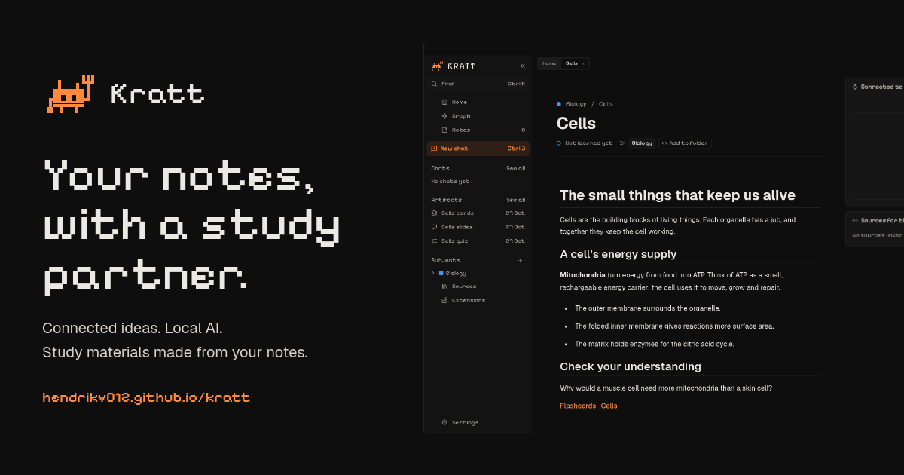
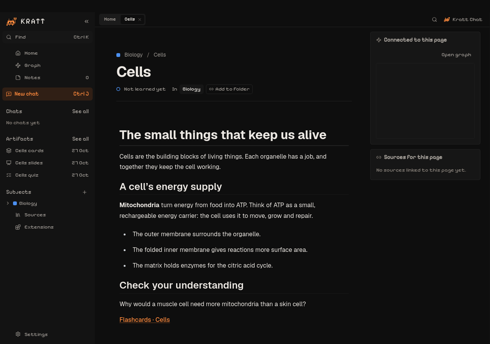
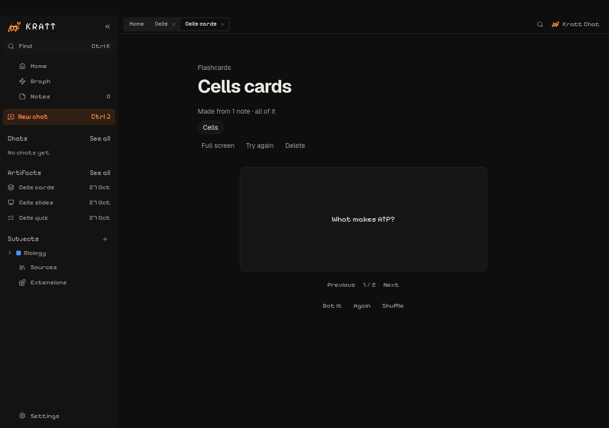

# Kratt

A desktop study workspace with connected notes and a local AI study partner. Gather your material, link the ideas, and turn your notes into flashcards, slides and quizzes.

[Explore Kratt](https://hendrikv012.github.io/kratt/) · [Preview builds](https://github.com/hendrikv012/kratt/actions/workflows/build-release.yml) · [Releases](https://github.com/hendrikv012/kratt/releases) · [Install guide](docs/INSTALL.md)

## A workspace for understanding

- **Connected notes.** Organise pages into subjects, keep sources close, and follow links between ideas.
- **Practice from your material.** Make flashcards, slides and quizzes in chat or directly from a note. Return to the original notes from each artifact.
- **Your files, on your computer.** Notes, sources, chats and study materials live in a Study folder as Markdown. Kratt starts its bundled engine automatically; no Python or engine commands are needed.
- **A local study partner.** Ollama runs the AI on your computer. Taking notes works without it.

See the Ember workspace and flashcards

The screenshots use example study material. Ember is the default; other app styles and light modes remain available.

## Try the desktop preview

Builds are available for Linux, macOS and Windows. The current previews are **unsigned**: macOS signing/notarization and Windows publisher signing are deferred. Draft releases are visible to repository maintainers; published downloads appear on the product site. See the [verification record](docs/desktop-verification.md) for tested packages and remaining manual checks.

## Work on Kratt

The app is in `apps/study`, the Python engine in `engine`, and the separate GitHub Pages product site in `site`.

[Repository guidelines](AGENTS.md) · [Build and release guide](docs/desktop-release.md) · [Architecture](docs/02_Architecture.md) · [Product specification](docs/desktop-product-spec.md) · [Ember design](docs/ember-brand.md)
