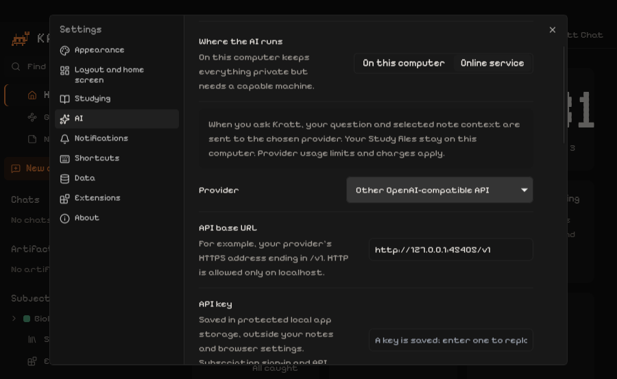

# AI providers in Kratt

Choose **Settings → AI → Where the AI runs**. Local Ollama remains the default. Online service sends each question and its selected note/chat context to the provider you explicitly choose. Notes and saved artifacts remain Markdown in your Study folder.

## Connect a provider

- **OpenAI API / Claude API:** paste your provider API key, save, load models, choose an available model and save again. API billing is separate from subscription sign-in; some plans may include provider-managed API credits.
- **Other OpenAI-compatible API:** enter its HTTPS base URL (usually ending in `/v1`), key and model ID. HTTP is accepted only on loopback for local servers. Changing the endpoint removes its previous key. This supports Chat Completions-compatible services, not every proprietary API protocol.
- **ChatGPT subscription:** choose Continue with ChatGPT, authorize Kratt in your system browser, then load models and select one. An eligible plan and permission to share plan usage are required. Saved accounts have separate registrations; choose an account or add another. ChatGPT usage opens the provider's usage/settings page. Sign out removes Kratt's local tokens and attempts remote revocation.
- **Claude subscription:** install the official Claude Code client if needed, choose Sign in to Claude, complete its browser login, and Check Claude connection. Choose a model alias such as `sonnet` or another supported ID. Kratt uses the official noninteractive client with tools, MCP, hooks and session persistence disabled, from a temporary directory. The installed client and a subscription login are prerequisites; Kratt does not bundle Claude Code or silently substitute API billing.

Chat, note questions and all artifact types use the same selected path. A provider failure, quota error or incomplete response stays an error; no partial artifact is saved. There is no automatic provider fallback.

Native screenshot using a local test API; replace its example address with your provider’s address.

## Storage and lifecycle

`ai-providers.json` is beside Kratt's `config.json`, outside Study. It is created with owner-only permissions on POSIX. It is a protected local credential file, not an encrypted vault; protect your OS account and backups. The UI sees key-present flags and account labels, not saved secrets. New keys are not written into browser settings. Claude authentication remains with its official client.

ChatGPT uses a stable `urn:uuid:<UUIDv4>` host identifier (1.4.1 migrates the bare UUID saved by 1.4.0), a dedicated loopback callback, fresh state/nonce/PKCE, the issued per-account client ID, JWKS signature/issuer/audience/expiry/nonce validation, and granted plan scopes. Refreshes are serialized and rotated tokens are persisted. Auth attempts expire after five minutes. Callback URLs and tokens are not logged. Requests use the public Responses API with `store:false`, require stream completion, and reject provider redirects.

The desktop retains Host/Origin/session-token checks. Its old Open Notebook bridge remains disabled; browser development can still use the legacy bridge. Internet connections come from the engine or official subscription client, not a Kratt-hosted backend.

## Provider contracts checked 2026-11-03

- [OpenAI registration and sign-in](https://developers.openai.com/siwc/token-sharing-open-source/sign-in): public-client registration, PKCE and OIDC validation.
- [OpenAI accounts and sessions](https://developers.openai.com/siwc/token-sharing-open-source/profiles-and-sessions): separate registrations, refresh, revocation and usage.
- [OpenAI models and inference](https://developers.openai.com/siwc/token-sharing-open-source/models-and-inference): account model catalog and completed Responses streaming.
- [Claude subscription support](https://support.claude.com/en/articles/15036540-use-the-claude-agent-sdk-with-your-claude-plan): current plan eligibility for `claude -p` and the SDK.
- [Claude CLI reference](https://code.claude.com/docs/en/cli-reference): print mode, tool restrictions, authentication and session persistence.

Provider availability and limits can change. Automated tests use fake responses and signed test tokens; they do not establish that a particular real account is eligible. A real successful request requires the user's own sign-in/key and access to the chosen model.

## Validation

Provider protocol, credential, OAuth identity/state/refresh and CLI-isolation tests use fake clients and signed test tokens. Run `engine/.venv/bin/pytest engine/tests/test_ai_providers.py engine/tests/test_desktop_product.py`. Frontend provider controls are covered by `OnlineAiRows.test.jsx`; chat and artifacts share the provider error path.

On a Linux graphical session with WebKitWebDriver, `python scripts/smoke_online_ai.py path/to/kratt` opens a separate temporary app profile and loopback fake provider. It checks the real packaged settings, model catalog, authenticated chat, Markdown save, secret separation, and provider restoration after clearing browser storage and restarting. It makes no real provider requests.
